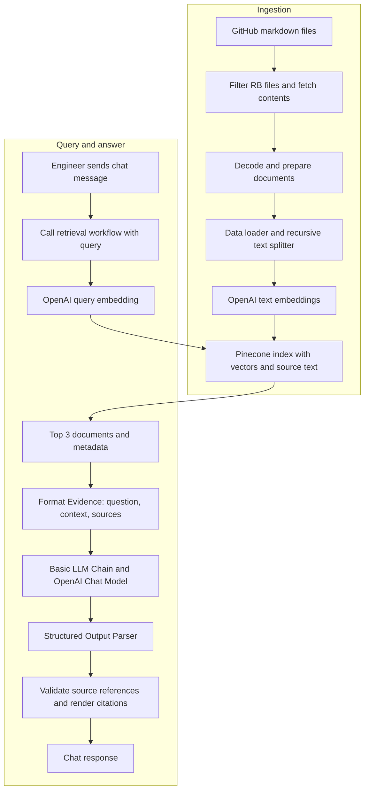

# Second Responder: a cited runbook assistant for on-call engineers

## 1. Project overview

Second Responder is a retrieval-augmented generation (RAG) prototype built with
n8n, Pinecone, and OpenAI. It helps an on-call engineer answer:

> What should I check, what should I do, and when should I escalate this alert?

The engineer uses a chat interface. The system retrieves relevant markdown
runbooks, sends their text as evidence to a language model, and returns ordered
instructions with links to the supporting runbooks. It provides advice; it does
not run the commands or change production infrastructure.

The development corpus contains twelve synthetic runbooks. The intended quality
target is at least 90% faithfulness on representative evaluation data, with
critical operational errors tracked separately. The experiments described here
are preliminary manual development reviews; they do not establish that target
across production traffic or a held-out test set.

Repository: [mahesh-ai-architect/Second-Responder](https://github.com/mahesh-ai-architect/Second-Responder).

## 2. Submission artifacts and current status

| Deliverable | Location | Status |
| --- | --- | --- |
| GitHub repository | Link above | Project source, exports, documentation, and evaluation artifacts included; Loom link pending |
| Detailed project document | This file | Prepared from development observations |
| Demo video under three minutes | Add the final Loom URL here after recording | Not recorded/linked yet |
| Demo narration and screen sequence | [docs/demo-script.md](docs/demo-script.md) | Prepared; rehearse against actual response latency |
| n8n workflow exports | [workflows/](workflows/README.md) | All three imported as copies and exercised; retrieval from the new ingestion namespace confirmed |
| Evaluation record | [Completed workbook](evaluation/results/Second-Responder-Eval-Results.xlsx) and [review summary](evaluation/manual-review-results.csv) | Nine scored responses with saved answers and evidence; CSV also records the unscored v2 retest |

The source artifacts and import checks are complete for this prototype. The
recorded Loom walkthrough and its final link remain to be added.

## 3. Problem and scope

During an incident, an engineer may need to identify a relevant runbook, find the
correct checks, preserve the conditions attached to remediation, and locate the
right escalation threshold. A fluent but incorrect answer can be operationally
misleading even when it includes a valid source link.

The prototype addresses that problem by requiring retrieval before generation
and keeping the source evidence available for review. Its current scope is
single-message runbook question answering. The interface supports multiple chat
messages, but session-aware conversational memory has not been implemented or
verified. Passing a session identifier through a Code node is not memory.

## 4. Corpus

The [runbook directory](runbooks/README.md) contains:

| ID | Topic |
| --- | --- |
| RB-001 | Payments `/charge` 5xx errors |
| RB-002 | Payments webhook delivery backlog |
| RB-003 | SSO login failures |
| RB-004 | MFA push delivery degradation |
| RB-005 | Stalled search index rebuild |
| RB-006 | Checkout latency after a deploy |
| RB-007 | Email/SMS notification backlog |
| RB-008 | Database replication lag |
| RB-009 | Database connection-pool exhaustion |
| RB-010 | CDN cache hit-ratio drop and edge 503s |
| RB-011 | Inventory stock-sync failures and oversell |
| RB-012 | Shared severity and escalation guidance |

The files contain symptoms, checks, diagnostic possibilities, remediation,
escalation guidance, and in some cases recovery criteria. Exact commands, flags,
error strings, and numerical boundaries make them useful for fidelity testing.
The corpus README identifies the data as synthetic learning material.

## 5. Architecture



The inspected chat export selects `gpt-5-mini` and serializes no model-option
overrides. The running environment is **n8n Cloud, version 2.43.7**, confirmed
by the user's About n8n screenshot during submission preparation. Node
`typeVersion` values do not identify the application release. This records the
observed environment, not a guarantee that Cloud will retain that release.

The diagram is conceptual. Model, loader, splitter, and parser connections appear
as attached sub-nodes in n8n. The design uses a fixed retrieval-before-answer
sequence; it does not rely on an agent choosing whether to retrieve evidence.

## 6. Workflow implementation

### 6.1 Ingestion

The manually built ingestion workflow lists the GitHub `runbooks` directory,
filters `type=file`, filenames starting `RB-`, and filenames ending `.md`, and
fetches each matching file. A Code node decodes GitHub base64 content and
prepares text plus filename, source URL, repository path, and file blob SHA.

A Loop Over Items node processes one document at a time. Pinecone Insert
Documents has these attached components:

- Default Data Loader: JSON, specific text from `{{ $json.text }}`.
- Recursive Character Text Splitter: 2000-character chunks with 200-character overlap.
- Embeddings OpenAI: `text-embedding-3-small`, 1536 dimensions.

The Pinecone index is `second-responder`, configured for 1536-dimensional dense
vectors and cosine similarity. The successful development snapshot contained
12 records in `second-responder-runbooks-9`.

The ingestion namespace was generated using the execution ID. A new run can
write a different namespace, so the retrieval workflow must be configured with
the exact populated namespace. A leading space in a namespace once caused zero
results despite a successful query execution; removing it fixed retrieval.

The document SHA is a Git blob SHA, not a commit identifier. Citation URLs point
to `main`. Evaluation records therefore retain the retrieved text used in a run.

### 6.2 Retrieval

The reusable retrieval workflow begins with **When Executed by Another
Workflow**, with a String input named `query`. Pinecone is configured in
**Get Many** mode with Prompt `{{ $json.query }}`, Limit 3, Include Metadata on,
and the same embedding model/dimensions used during ingestion.

It returns separate items shaped like:

```json
{
  "document": {
    "pageContent": "Retrieved runbook text",
    "metadata": {
      "filename": "RB-001-payments-api-5xx.md",
      "source": "https://github.com/mahesh-ai-architect/Second-Responder/blob/main/runbooks/RB-001-payments-api-5xx.md"
    }
  },
  "score": 0.0
}
```

The score above is a shape illustration, not an observed result. Retrieval
similarity is not the probability that an answer is correct or faithful.

### 6.3 Chat and cited answer generation

The third workflow follows this sequence:

1. **Chat Trigger** receives `chatInput`.
2. **Execute Sub-workflow** maps `query` to `{{ $json.chatInput }}` and waits for retrieval.
3. **Format Evidence**, a JavaScript Code node running once for all items,
   combines the documents into one item. Each source receives a local identifier
   such as `S1`, `S2`, or `S3`.
4. **Basic LLM Chain** receives the question and formatted source text, along
   with the System instructions. Its OpenAI chat model is an attached sub-node.
5. **Structured Output Parser** requires the response fields described below.
6. **Render Cited Answer**, another Code node, checks source references and
   maps them to the retrieved GitHub URLs.
7. **Chat Trigger**, using **When Last Node Finishes**, returns the final
   `output` string to the engineer.

The structured response contract is:

```json
{
  "status": "answered",
  "steps": [
    {
      "section": "Conditional remediation",
      "text": "If the connection pool is saturated, follow RB-009.",
      "source_ids": ["S1"]
    }
  ],
  "clarifying_question": ""
}
```

This example shows the schema and a source-supported conditional action. Source
IDs are assigned per retrieval execution, so `S1` is not permanently RB-001.

Allowed section labels are **First checks**, **Conditional remediation**,
**Escalation**, and **After resolution**. When evidence is insufficient, the
prompt requests `needs_clarification`, an empty steps array, and one focused
clarifying question. This behavior still needs broader negative-case testing.

The renderer catches missing or invalid references and uses stored source URLs
instead of relying on model-generated URLs. It does not establish that a cited
source semantically supports the claim. That distinction was central to the
evaluation findings.

## 7. Prompt experiment

### Observed failure

The first payments answer included a valid RB-001 citation but broadened the
condition for following RB-009. The source distinguishes:

```text
Possible diagnosis: “no healthy upstream” can indicate a pool or target-pod problem.
Authorized action: Pool saturation: follow RB-009.
```

The answer instead recommended RB-009 for the symptom or a suspected pool/pod
problem. A supported diagnostic possibility had become an unsupported action
trigger. This was recorded as a critical error even though the manual
faithfulness score was 16/17, approximately 94%.

### Prompt v2

A focused prerequisite-preservation block and example were appended to the
existing prompt. One retest still produced the broadened condition. The full
text supplied during that test is in [system-v2.txt](prompts/system-v2.txt).

### Prompt v3

[System v3](prompts/system-v3.txt) consolidated the instructions and asked the
model to construct remediation from the source action instruction, preserve its
prerequisite, and keep diagnostic possibilities separate. It also clarified
section labels, unestablished alternatives, and explicit recovery requirements.
The parser and output schema stayed the same.

Two reviewed v3 executions preserved the prerequisite:

> If the connection pool is saturated, follow RB-009.

The scores were 14/14 (100%) and 12/13 (92%), with no critical error identified
in those runs. The second answer altered the deploy-feed check, which received a
conservative support deduction. Because several prompt instructions changed,
these observations cannot isolate the effect of one instruction. Because the
prompt includes an example from this payments case, the runs are development
tests rather than held-out evaluation.

## 8. Evaluation method and results

The [simple evaluation workbook](evaluation/Second-Responder-Simple-Eval.xlsx)
uses one row per answer:

| Field | Purpose |
| --- | --- |
| Question | Exact engineer input |
| Chatbot answer | Unchanged generated response |
| Retrieved evidence / sources | Source text and references from the same execution |
| Supported claims | Manually judged supported assertions/instructions |
| Total claims | All evaluated assertions/instructions |
| Faithfulness | Supported divided by total; calculated by Excel |
| Critical error? | Separate operational-error flag |
| Notes / what to fix | Prompt version, review judgments, and corrections |

An atomic claim is a checkable factual assertion or operational instruction. A
numbered step can contain multiple claims, while an action's prerequisite stays
attached to the action. Repeated advice was counted where it appeared in
different sections during these reviews. Reviewers should record their
decomposition to make comparisons reproducible.

Faithfulness is evaluated against the evidence actually retrieved for that
execution, not unrestricted background knowledge. A zero-claim answer is N/A
and needs a separate appropriateness check; abstaining on every question should
not earn a successful system evaluation. Command correctness, relevance,
completeness, and critical errors should also be inspected independently.

### Reviewed development results

| Case | Prompt label | Supported / total | Rounded faithfulness | Critical error |
| --- | --- | --- | --- | --- |
| Payments 5xx | Baseline before v3 | 16 / 17 | 94% | Yes |
| Webhook backlog | Baseline before v3 | 11 / 11 | 100% | No |
| SSO failure | Baseline before v3 | 15 / 17 | 88% | No |
| MFA push | Baseline before v3 | 9 / 9 | 100% | No |
| Search index | Baseline before v3 | 16 / 17 | 94% | No |
| Checkout latency | Baseline before v3 | 10 / 11 | 91% | No |
| Notification backlog | Baseline before v3 | 11 / 11 | 100% | No |
| Payments retest | v2 | Not fully scored | Not assigned | Yes |
| Payments retest 1 | v3 | 14 / 14 | 100% | No |
| Payments retest 2 | v3 | 12 / 13 | 92% | No |

These values are transcribed from the development conversation in
[manual-review-results.csv](evaluation/manual-review-results.csv). They are
manual judgments, not Ragas outputs. Some deductions reflect a deliberately
conservative interpretation of recovery criteria or ambiguous alternatives.
The baseline rows do not assert a separately archived prompt snapshot for each
execution. The [completed workbook](evaluation/results/Second-Responder-Eval-Results.xlsx)
contains the nine scored answers and their retrieved evidence. Three capture
gaps were restored from earlier user submissions without changing scores;
the [capture review](evaluation/results/README.md) documents those repairs.

The results demonstrate a discovered failure and a promising prompt revision.
They do not establish 90% faithfulness across all runbooks or unseen traffic.
Seven runbooks have baseline question reviews in this record. No held-out set,
calibrated independent grader, or statistical confidence bound was produced.

## 9. Privacy and access

Sensitive text would cross external-service boundaries in this architecture:

- Ingestion sends runbook text to OpenAI for embeddings.
- Retrieval sends the engineer's question for query embedding.
- Generation sends the question and retrieved text to the chat model.
- Pinecone stores document text/metadata alongside vectors in this setup.
- Saved n8n execution data and evaluation files can contain the same material.

A prompt instructing the model not to reveal PII does not prevent input from
being transmitted. If sensitive content must be withheld, sanitization must
precede the relevant external call. Provider processing, training use, and
retention are different issues; account-specific retention settings were not
audited in this project. Synthetic data is used for the public assignment.

The Chat Trigger supports a hosted URL and authentication. A production pilot
should restrict access, and any document-level access requirements should be
enforced before retrieved evidence reaches the model. That authorization layer
has not been implemented in this prototype.

## 10. Reproduction and submission

Follow [docs/setup.md](docs/setup.md) and the
[submission checklist](docs/submission-checklist.md). The submission steps are:

1. Review the three prepared workflow JSON files before committing. Their
   original linkage and query input contract have been checked locally.
2. Review the completed evaluation workbook and its capture-repair provenance in
   `evaluation/results/`.
3. Retain the [import verification record](docs/import-verification.md): all three
   exports were imported as copies. Ingestion created
   `second-responder-runbooks-52` with 12 records; retrieval execution 56
   (parent 55) confirms the imported chat read three documents from that new data.
   This functional test was not claim-scored.
4. Commit and push the reviewed artifacts to GitHub, verify the resulting tree,
   record the demo, and add the Loom link to this document.

The n8n JSON files contain Code-node JavaScript and model/prompt parameters. They
are the required source of truth for reproducing the running workflows.
Extracted JavaScript is in [code/](code/README.md). Thirteen local checks of the
exported Code nodes passed; they do not call APIs, execute n8n, or evaluate model
faithfulness. The [export manifest](workflows/export-review.json) documents
preparation changes and the verified original chat-to-retrieval dependency.
The Python files in `evaluation/` generate templates; the script in `scripts/`
prepares exports. Neither is the RAG runtime.
The template dependency is listed in [requirements.txt](requirements.txt).

## 11. Next improvements

- Complete baseline coverage of RB-008 through RB-012.
- Repeat v3 tests and check other runbooks for prompt regressions.
- Add unseen paraphrases, conditional boundaries, multi-runbook cases, and
  ambiguous/unsupported questions.
- Calibrate automatic claim-support grading against engineer-reviewed labels.
- Add conversation history and evaluate multi-turn behavior if required.
- Add pre-call redaction, access enforcement, and reviewed retention settings for
  any deployment with actual organizational information.

## 12. References

- [n8n workflow export/import](https://docs.n8n.io/workflows/export-import/)
- [n8n Pinecone Vector Store](https://docs.n8n.io/integrations/builtin/cluster-nodes/root-nodes/n8n-nodes-langchain.vectorstorepinecone/)
- [n8n Basic LLM Chain](https://docs.n8n.io/integrations/builtin/cluster-nodes/root-nodes/n8n-nodes-langchain.chainllm/)
- [n8n Chat Trigger](https://docs.n8n.io/integrations/builtin/core-nodes/n8n-nodes-langchain.chattrigger/)
- [Ragas faithfulness](https://docs.ragas.io/en/stable/concepts/metrics/available_metrics/faithfulness/)
- [OpenAI prompting guidance](https://developers.openai.com/api/docs/guides/prompt-engineering)
- [OpenAI evaluation guidance](https://developers.openai.com/api/docs/guides/evaluation-best-practices)
- [OpenAI API data controls](https://developers.openai.com/api/docs/guides/your-data)
