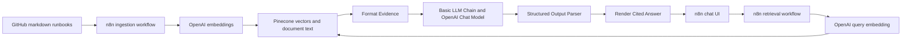

# Second Responder

Second Responder is an n8n RAG prototype that helps on-call engineers answer
“What should I do for this alert?” using 12 service runbooks. It retrieves
runbook evidence from Pinecone and generates ordered steps with GitHub citations.

The corpus is synthetic learning data. The response is advisory: this prototype
does not execute the runbook commands.

Assignment deliverables: [detailed project document](PROJECT.md) and
[under-three-minute demo script](docs/demo-script.md). Add the recorded Loom URL
to the project document after recording.

## Submission status

The three workflows have been built and tested manually in n8n. All three
reviewed exports are present in [`workflows/`](workflows/README.md), and their
input contracts and local Code-node checks pass.
All three exports were imported as copies in the user's n8n Cloud instance.
Ingestion created a new namespace with 12 records, and the imported chat/retrieval
copies returned an answer from that data after explicitly selecting **When Last
Node Finishes**. See the [import check and its limits](docs/import-verification.md).
The [completed evaluation workbook](evaluation/results/Second-Responder-Eval-Results.xlsx)
contains nine scored responses with saved answers and evidence. Separate blank
templates remain available in `evaluation/`.

The Loom recording and final submission links remain to be completed. Setup was
checked in the existing account; a separate-account installation was not tested.
Use the [submission checklist](docs/submission-checklist.md) to finish packaging it.

## Architecture



The diagram shows the processing sequence. In the n8n canvas, the embedding
model and output parser are attached sub-nodes.

## Workflows

| Workflow | Purpose | Export status |
| --- | --- | --- |
| Ingestion | Fetch, decode, split, embed, and insert markdown runbooks | [01-ingestion.json](workflows/01-ingestion.json), reviewed |
| Retrieval | Accept a `query` string and return the top three documents | [02-retrieval.json](workflows/02-retrieval.json), reviewed |
| Chat | Retrieve evidence, generate a structured answer, and render citations | [03-chat.json](workflows/03-chat.json), reviewed |

The retrieval workflow was named **Second Responder — Retrieval Test** in n8n.
The chat-to-retrieval reference was checked against the original downloads.
Reconnect credentials and reselect the imported retrieval workflow after import.

## Contents

- [`runbooks/`](runbooks/README.md): 12 synthetic markdown runbooks covering eight services and a shared escalation guide.
- [`workflows/`](workflows/README.md): instructions for adding and importing the real workflow exports.
- [`code/`](code/README.md): JavaScript extracted from the reviewed exports.
- [`scripts/prepare_workflows.py`](scripts/prepare_workflows.py): review/export preparation helper.
- [`tests/workflow-code.test.cjs`](tests/workflow-code.test.cjs): local Code-node checks using synthetic inputs and no external API calls.
- [`prompts/system-v2.txt`](prompts/system-v2.txt): the complete prompt used in the unsuccessful focused-rule retest.
- [`prompts/system-v3.txt`](prompts/system-v3.txt): the consolidated prompt used in the two successful critical-condition retests.
- [`evaluation/README.md`](evaluation/README.md): manual scoring method, templates, and result provenance.
- [`evaluation/manual-review-results.csv`](evaluation/manual-review-results.csv): numerical reviews transcribed from the development conversation.
- [`docs/setup.md`](docs/setup.md): configuration and reproduction steps.
- [`docs/findings.md`](docs/findings.md): observations, prompt changes, privacy boundaries, and limitations.

## Configuration used in development

| Setting | Value |
| --- | --- |
| Embedding model | OpenAI `text-embedding-3-small` |
| Vector dimensions | 1536 |
| Pinecone index | `second-responder` |
| Pinecone similarity metric | Cosine |
| Observed populated namespace | `second-responder-runbooks-9` |
| Retrieval limit | 3 |
| Text splitter | Recursive Character Text Splitter |
| Chunk size / overlap | 2000 / 200 characters |
| Chat model | `gpt-5-mini`, confirmed in the chat export; no model-option overrides serialized |
| n8n application version | `2.43.7`, confirmed in the About n8n dialog |
| Deployment | n8n Cloud |

Namespace `second-responder-runbooks-9` is the observed development snapshot,
not a resource included in this repository. A fresh setup must ingest its own
documents and use the resulting namespace for retrieval.

## Evaluation

Faithfulness is reviewed manually as **supported claims / total claims** using
the retrieved evidence from the same execution. Conditions stay attached to
their actions. An unsupported command, remediation trigger, or escalation
threshold is also tracked as a critical error independently of the percentage.

The first payments response scored **16/17 (94%)** but contained a critical
condition error. Prompt v3 preserved the pool-saturation prerequisite in two
reviewed runs: **14/14 (100%)** and **12/13 (92%)**, both with no critical error
identified under the current rubric. The second run had a noncritical alteration
to the deploy-feed check.

These are development observations, not a validated 90% system-wide result.
The prompt contains an example from the same payments case, so these runs are
not held-out tests. Read [evaluation details](evaluation/README.md).

## Local spreadsheet tooling

Python 3 and `XlsxWriter` are needed only to regenerate the scoring templates.
n8n executes the application logic. A virtual environment is optional:

```sh
python3 -m venv .venv
source .venv/bin/activate
python -m pip install -r requirements.txt
```

The generator scripts recreate their named template files. Keep completed
evaluations in `evaluation/results/` and preserve a copy before regenerating a
template.

## Local Code-node checks

With Node.js 20 available, run:

```sh
node --test tests/workflow-code.test.cjs
```

All 13 local checks passed after the three exports were prepared.
They cover decoding, evidence formatting, citation rendering/rejection, and
clarification handling, and the query/embedding configuration contracts. One test explicitly demonstrates that reference
validation does not detect an unsupported instruction. These checks do not
execute n8n, call models, verify Pinecone ingestion, or establish faithfulness.
The raw-renderer comparison is skipped when ignored originals are absent.

## Data boundaries

Runbook text is sent to OpenAI during embedding. The engineer's question is sent
for query embedding, and the question plus retrieved text is sent to the chat
model. Pinecone stores document text/metadata as well as vectors in this setup.
Stored n8n execution data and evaluation workbooks can contain the same text.
Public submission material should use only the synthetic corpus and reviewed
exports. API keys belong in n8n credentials, not repository files.
